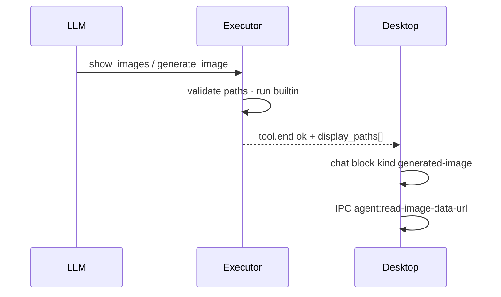

# 聊天内联图片展示

> **状态**：v0.1.0 · 2026-10-21 · Desktop unified 主战场  
> **相关**：`generate_image`（生图）· [TOOLS.md](./TOOLS.md) §7.5.1 · [CHAT-OUTPUT-POLISH.md](./CHAT-OUTPUT-POLISH.md)

## 1. 目标

用户在 **Desktop 聊天主区** 看到图片本身，而不是只有 `workspace/.../foo.png` 路径文本。

- **生图**：`generate_image` 成功后自动内联展示输出 PNG。
- **已有图**：Agent 调用只读 builtin **`show_images`**，把 agent root 下已有图片文件展示在同一条时间线里。
- **统一通道**：工具结果里的 **`display_paths`**（agent 相对路径字符串数组）经 `tool.end` 事件送到前端；前端不依赖工具名硬编码（`generate_image` 仅作旧事件回退）。

## 2. 非目标

- 不在聊天里嵌入任意 URL 或 `file://`（安全与 SSRF 边界见 `fetch_url` / 预览 Phase 65）。
- 不做全盘图片索引或后台扫描（历史附件解析仍仅限 `image_references` 会话 JSONL，与 `generate_image` 一致）。
- Terminal 壳不保证内联渲染（维护面；Desktop 为验收面）。

## 3. 数据流

| 阶段 | 责任方 | 说明 |
|------|--------|------|
| 路径校验 | `show_images` / `generate_image` | `resolve_read_path` + 图片后缀白名单 |
| 结构化结果 | `ToolResult.data` | `display_paths: string[]`（agent 相对） |
| 事件 | `ToolExecutor` | `tool.end.display_paths` 透传 |
| UI | `chat-state.ts` | 每路径一个 `generated-image` block |
| 像素加载 | `unified/index.ts` | `hydrateGeneratedImages()` · `readAgentImageDataUrl` |

## 4. Builtin：`show_images`

| 项 | 值 |
|----|-----|
| 文件 | `agent-core/tools/builtin/show_images.py` |
| confirm | **否** |
| 只读 | **是**（read_only 轮次可用） |
| ask 模式 | **可见**（与 `read_file` 同类观察） |
| 参数 | `paths[]`（1～12）；可选 `reference_context` / `reference_id` |
| 失败 | 全部路径无效 → `no_images`；部分跳过时在 `data.skipped` |

**何时调用（模型指引）**

- 用户说「把刚才那张图再显示一下」「打开 artifacts 里那张 PNG」。
- `generate_image` 已写入磁盘，但用户从旧会话回放或 spill 摘要里只有路径。
- 多图：`paths` 顺序即聊天内从上到下顺序。

**何时不要调用**

- 用户要**新生成**图片 → `generate_image`（确认 + 可能扣费）。
- 路径未知 → 先 `glob_file_search` / `list_dir`，再 `show_images`。

## 5. Agent 可见性（避免「已经展示还问要不要看」）

Desktop 内联展示**不会**自动变成用户消息里的图片附件；父模型只读 **tool 结果 JSON**。

成功且含 `display_paths` 时，执行器会注入：

| 字段 | 含义 |
|------|------|
| `desktop_chat_inline_display` | `true` — UI 已内联出图 |
| `llm_hint` | 明确写：用户已在聊天里看到图，**不要再问「要不要展示」** |

过程轨 `tool.end.summary` 也会显示「已在聊天内联展示图片」类文案，便于人对照。

工具 schema 说明（`agent.py` `_BUILTIN_DESCRIPTIONS`）与上一致。

## 6. `generate_image` 与 `display_paths`

成功写盘后在 `data` 中同时返回：

- `path`：主输出（兼容旧 UI / spill）
- `display_paths`：`[path]`（统一展示通道）

## 7. 会话重载（重启后仍可见）

`session.history` 在构建 user/assistant 条目时扫描 `messages.jsonl` 里的 **`role: tool`** 结果：

- 成功且 `tool` 为 `generate_image` / `show_images`
- 从 `data.display_paths` 取路径（旧会话无该字段时，`generate_image` 回退 `data.path`）

路径挂在**紧随其后的下一条 assistant 正文**上的 `inline_images[]`；Desktop `historyFromItems` 在渲染该气泡前插入 `generated-image` 块，再走 IPC hydrate。

因此：**重启 / 切换会话回来应能再次看到历史内联图**（文件仍在 agent root 下）。

## 8. Desktop 实现锚点

| 文件 | 作用 |
|------|------|
| `desktop/electron/agent-file-preview.ts` | 读 agent 内图片 → data URL |
| `desktop/electron/main.ts` | IPC `agent:read-image-data-url` |
| `desktop/src/shells/chat-state.ts` | `tool.end` → blocks |
| `desktop/src/shells/unified/index.ts` | 渲染 + hydrate |
| `desktop/src/shells/unified/unified.css` | `.unified-generated-image-wrap` |

## 9. 验收

| ID | 类型 | 内容 |
|----|------|------|
| IT-6600 | 单测 | `show_images` 路径校验 · `display_paths` · executor `tool.end` |
| IT-6601 | 单测 | `generate_image` 成功含 `display_paths` |
| S-6600 | 手工 | 生图后聊天内可见缩略图；刷新会话仍可 hydrate |
| S-6601 | 手工 | `show_images` 展示已有 workspace/artifacts PNG |

## 10. 故障排查

| 现象 | 常见原因 | 处理 |
|------|----------|------|
| 破图 + 仅文件名 alt | 未重启桌面/sidecar（preload 无 `readAgentImageDataUrl`） | **完全退出**托盘/Electron 后重开；sidecar 需加载含 `show_images` 的 agent-core |
| 破图 +「路径或文件不存在」 | `workspace/_drops/...` 下 PNG 已删或 agent 根不一致 | 用资源管理器确认文件存在；路径须为 agent 相对（含 `workspace/` 前缀） |
| 有占位、刷新后又破图 | 聊天重绘后未重新 hydrate（已修：data URL 缓存） | 升级到含 T-6603 修复的 desktop 构建 |
| 只有路径文字、无图块 | Agent 未调 `show_images` / 旧 sidecar 无 `display_paths` | 让 Agent 调用 `show_images`；或重启 sidecar |

## 11. 后续（非本版）

- `search_images`（按目录 glob + 展示）— 未排期。
- 与 Phase 65 预览截图共用 data URL 管道 — 可复用 IPC，UI 槽位不同。
